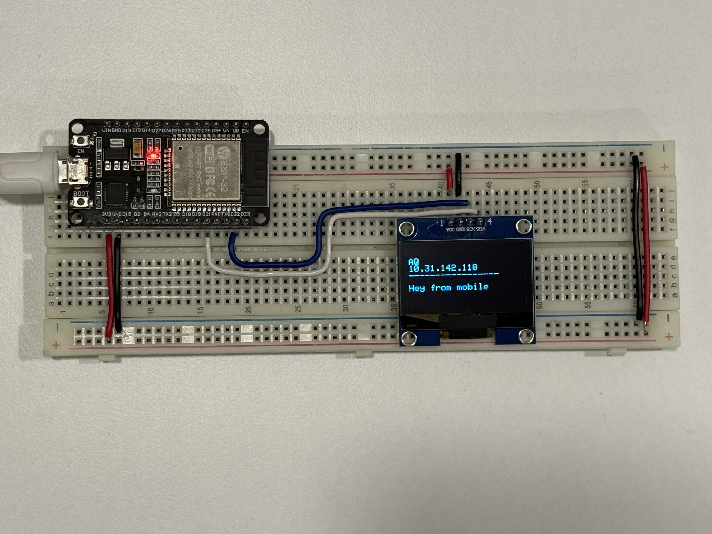

# ESP32 Wi-Fi OLED Web Server -- Remote Text Display

## 1. Project Overview

This project demonstrates how to use an **ESP32 development board** with
an OLED display and Wi-Fi connectivity to create a simple web-based text
display system.

The ESP32 hosts a lightweight HTTP web server that allows users to
connect through a web browser and send custom text messages to the OLED
display.

The project uses **WiFiManager** to simplify Wi-Fi configuration.
Instead of hardcoding Wi-Fi credentials into the source code, the ESP32
can create its own Access Point (AP), allowing users to configure the
wireless network through a captive portal.




### Key Features

-   ESP32 Wi-Fi connectivity.
-   Wi-Fi configuration using WiFiManager.
-   Access Point mode for initial network configuration.
-   HTTP web server running on port 80.
-   Browser-based interface for sending text messages.
-   OLED display updates when a message is submitted.
-   Displays the connected Wi-Fi SSID and IP address.
-   Attempts to reconnect if Wi-Fi connectivity is lost.

## 2. Hardware Requirements

  Component      Description
  -------------- -----------------------------------
  ESP32          ESP32 DevKit V1
  OLED Display   SH1106, 128 × 64
  USB Cable      Programming and power
  Wi-Fi Router   Network and internet connectivity
  Jumper Wires   Hardware connections

## 3. Hardware Connections

The OLED display communicates with the ESP32 through the I2C interface.

### OLED to ESP32 Wiring

  OLED Pin   ESP32 Pin   Description
  ---------- ----------- -------------
  VCC        3.3V        Power
  GND        GND         Ground
  SDA        GPIO 21     I2C Data
  SCL        GPIO 22     I2C Clock

### OLED Configuration

-   Display controller: SH1106
-   Resolution: 128 × 64
-   I2C address: `0x3C`
-   Communication protocol: I2C

## 4. Required Arduino Libraries

Install the following libraries using the Arduino IDE Library Manager.

  Library           Purpose
  ----------------- -----------------------------
  WiFi              ESP32 wireless connectivity
  WebServer         HTTP web server
  Wire              I2C communication
  Adafruit GFX      Graphics and text rendering
  Adafruit SH110X   SH1106 OLED driver
  WiFiManager       Wi-Fi configuration portal

### Library Installation

1.  Open Arduino IDE.
2.  Navigate to **Sketch → Include Library → Manage Libraries**.
3.  Search for and install:
    -   Adafruit GFX Library
    -   Adafruit SH110X
    -   WiFiManager by tzapu
4.  Make sure the ESP32 board package is installed through Boards
    Manager.

`WiFi.h`, `WebServer.h`, and `Wire.h` are provided by the ESP32 Arduino
core and generally do not need to be installed separately.

## 5. How the Project Works

The project follows this workflow:

1.  The ESP32 starts and initializes the OLED display.
2.  WiFiManager attempts to connect to a configured Wi-Fi network.
3.  If configuration is required, the ESP32 creates an Access Point.
4.  The user connects a phone or computer to the ESP32 Access Point.
5.  The user configures the target Wi-Fi network through the
    configuration portal.
6.  The ESP32 connects to the selected Wi-Fi network.
7.  The OLED displays the Wi-Fi SSID and assigned IP address.
8.  The HTTP web server starts listening on port 80.
9.  The user opens the ESP32 IP address in a web browser.
10. The user enters a message and submits the form.
11. The ESP32 receives the message and updates the OLED display.

## 6. Connecting the ESP32 to Wi-Fi and the Internet

WiFiManager provides a configuration portal so that Wi-Fi credentials do
not need to be hardcoded into the sketch.

### Step 1 -- Power on the ESP32

Connect the ESP32 to your computer or a USB power source.

The OLED should briefly display:

``` text
Booting...
```

The ESP32 then starts the Wi-Fi configuration process.

### Step 2 -- Connect to the ESP32 Access Point

When WiFiManager enters configuration mode, the ESP32 creates a wireless
Access Point.

  Parameter                 Value
  ------------------------- ------------------------------------------------------
  Access Point SSID         `IOT-ESP32`
  Password                  Open network (no password configured in this sketch)
  Default Access Point IP   `192.168.4.1`

On your phone or computer:

1.  Open the Wi-Fi settings.
2.  Find and connect to `IOT-ESP32`.
3.  If your device reports that the network has no internet access,
    choose to remain connected.

### Step 3 -- Open the Wi-Fi Configuration Portal

A captive portal may open automatically.

If it does not:

1.  Open a web browser.
2.  Browse to `http://192.168.4.1`.
3.  Select **Configure WiFi**.
4.  Select your home or office Wi-Fi network.
5.  Enter the Wi-Fi password.
6.  Save the configuration.

The ESP32 will attempt to connect to the selected network.

**Network compatibility:** The ESP32 generally connects to 2.4 GHz Wi-Fi
networks. A 5 GHz-only network is not supported by the ESP32's built-in
Wi-Fi radio.

### Step 4 -- Verify the Connection

After a successful connection, the OLED displays the connected network
name and the IP address assigned by the router.

Example:

``` text
MyHomeWiFi
192.168.1.105
```

Your actual IP address will depend on your router's network
configuration.

You can also open the Arduino Serial Monitor at **115200 baud** to view
serial output.

### Step 5 -- Access the Web Interface

Once the ESP32 is connected to your Wi-Fi network:

1.  Connect your phone or computer to the same Wi-Fi network.
2.  Open a web browser.
3.  Enter the ESP32 IP address shown on the OLED.

Example:

``` text
http://192.168.1.105
```

The web page displays a form titled **Send Text to OLED**.

1.  Enter a message.
2.  Click **Send**.
3.  The ESP32 receives the message.
4.  The OLED is updated with the submitted text.

### Does the ESP32 Need Internet Access?

The ESP32 web server works over the local network. Internet access is
not required to send messages from a device on the same Wi-Fi network to
the ESP32.

The router provides internet access separately. The ESP32 and the
browser device simply need to be able to communicate over the local
network.

## 7. Web Interface

The project provides a simple HTML page with a text input and a Send
button.

Example message:

``` text
Hello ESP32!
```

After submission, the OLED displays the network information and the
received message:

``` text
MyHomeWiFi
192.168.1.105
-----------------
Hello ESP32!
```

The display is limited to 128 × 64 pixels. Long messages may not fit on
the screen without additional text-wrapping or scrolling logic.

## 8. HTTP Endpoints

The ESP32 WebServer library provides an HTTP server on port 80.

The sketch defines two routes:

  Endpoint   HTTP Method   Function
  ---------- ------------- -----------------------------------------------------
  `/`        GET           Displays the HTML web interface
  `/send`    GET           Receives the submitted message and updates the OLED

### Root Handler

The `handleRoot()` function returns the HTML page:

``` cpp
void handleRoot() {
  server.send(200, "text/html", htmlPage());
}
```

### Message Handler

The `handleSend()` function checks for the `msg` parameter, retrieves
its value, and displays it:

``` cpp
void handleSend() {
  if (server.hasArg("msg")) {
    displayText = server.arg("msg");
    // Update OLED display
  }

  server.send(200, "text/html", htmlPage());
}
```

## 9. Important Code Configuration

### Wi-Fi Access Point Name

``` cpp
bool res = wm.autoConnect("IOT-ESP32");
```

This configures the Access Point name used by WiFiManager when
configuration is required.

### HTTP Server Port

``` cpp
WebServer server(80);
```

This initializes the HTTP server on port 80.

### OLED Initialization

``` cpp
Adafruit_SH1106G display(128, 64, &Wire, -1);
```

This configures the SH1106 OLED display with a resolution of 128 × 64.

### Message Retrieval

``` cpp
if (server.hasArg("msg")) {
    displayText = server.arg("msg");
}
```

This retrieves the message submitted through the browser.

## 10. Important Note: Wi-Fi Credential Persistence

The current sketch includes:

``` cpp
wm.resetSettings();
```

This command clears WiFiManager's saved settings every time the ESP32
starts. As a result, the ESP32 will enter the Wi-Fi configuration
process again after each restart.

If you want the ESP32 to remember previously configured Wi-Fi
credentials, remove or comment out this line:

``` cpp
// wm.resetSettings();
```

WiFiManager can then attempt to reconnect using saved credentials on
subsequent boots.

To configure a different network later, implement a dedicated reset
button or another intentional way to enter configuration mode.

## 11. Wi-Fi Reconnection Behaviour

The `loop()` function checks whether the ESP32 is connected to Wi-Fi:

``` cpp
if (WiFi.status() != WL_CONNECTED) {
    WiFi.reconnect();
    // Display reconnecting status
}
```

If the connection is lost, the sketch calls `WiFi.reconnect()` and
displays a reconnection message.

This is a basic reconnection approach. For a more robust implementation,
consider using a timed retry strategy and handling reconnection failures
without blocking the web server for extended periods.

## 12. Security Considerations

This implementation is intended for learning and local IoT
experimentation. It should not be exposed directly to the public
internet in its current form.

Before using a similar design in a production environment, consider:

-   Adding authentication to the web interface.
-   Using HTTPS or another protected communication mechanism where
    appropriate.
-   Using HTTP POST rather than GET for message submission.
-   Validating and limiting the length of user-submitted text.
-   Protecting Wi-Fi credentials and configuration access.
-   Avoiding direct public exposure of the ESP32 web server.
-   Using a password-protected configuration Access Point.
-   Considering network segmentation for IoT devices.

The current sketch uses an open configuration Access Point and an
unauthenticated HTTP endpoint. Anyone who can reach the web server may
be able to submit text to the display.

## 13. Troubleshooting

  -----------------------------------------------------------------------
  Issue                               Possible Solution
  ----------------------------------- -----------------------------------
  OLED does not initialize            Verify I2C wiring and address
                                      `0x3C`.

  ESP32 Access Point is not visible   Restart the ESP32 and check the
                                      Serial Monitor.

  Configuration portal does not open  Browse to `http://192.168.4.1`
  automatically                       while connected to `IOT-ESP32`.

  ESP32 cannot connect to Wi-Fi       Verify the password and use a
                                      compatible 2.4 GHz network.

  Web interface is unavailable        Check the ESP32 IP address and
                                      confirm both devices are on the
                                      same local network.

  OLED does not update                Check the `/send` endpoint and I2C
                                      connections.

  ESP32 repeatedly asks for Wi-Fi     Remove `wm.resetSettings()` if
  configuration                       saved credentials should persist.

  IP address has changed              Check the current address displayed
                                      on the OLED.
  -----------------------------------------------------------------------

## 14. Future Enhancements

Potential improvements include:

-   Password protection for the web interface.
-   HTTPS support.
-   HTTP POST for message submission.
-   Input validation and message-length limits.
-   A dedicated Wi-Fi reset button.
-   Text wrapping and scrolling for long messages.
-   WebSocket support for live updates.
-   MQTT integration for IoT messaging.
-   Support for multiple clients.
-   Improved Wi-Fi reconnection handling.

## 15. Project Summary

This project demonstrates a practical ESP32 IoT implementation
combining:

-   Embedded systems programming.
-   Wi-Fi configuration and connectivity.
-   HTTP communication.
-   Web-based user interaction.
-   I2C peripheral communication.
-   OLED display management.

It provides a foundation for developing more advanced IoT applications
where embedded devices can be controlled and monitored through a web
interface.

## 16. License

This project is intended for educational and experimental purposes. You
may adapt and extend the implementation for your own IoT projects. Add a
specific open-source license file to the repository if you want to
define formal reuse and distribution terms.
